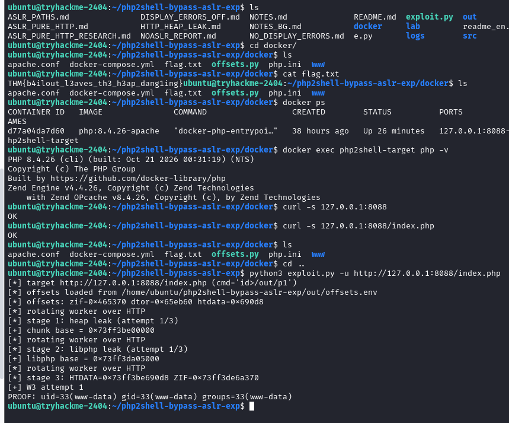

# PHP2Shell – Bypass ASLR (TryHackMe) Writeup

## 1. Title & Metadata

- **Lab:** PHP2Shell – Bypass ASLR (TryHackMe)
- **Platform:** TryHackMe
- **Date completed:** October 24, 2026
- **Difficulty:** Easy
- **Target:** Dockerized PHP 8.4.26 (Apache) instance, intentionally left unpatched against CVE-2026-109618 / CVE-2026-109619

## 2. Summary

This lab demonstrates CVE-2026-109618 and CVE-2026-109619, two critical vulnerabilities in the PHP runtime itself that allow an unauthenticated attacker to achieve remote code execution (RCE). No login credentials are required a single crafted HTTP request is enough to trigger the chain.

## 3. Objective

The goal of this room was to understand the PHP runtime vulnerability and achieve RCE against the vulnerable container, retrieving a flag as proof of exploitation.

**Starting info given:**

- Machine IP address:10.48.158.159 (lab-internal, non-routable)
- SSH credentials:username-ubuntu password-tryhackme (username/password-based access to the attack box)

## 4. Recon

Before touching the target, I connected via the room's OpenVPN config and verified connectivity with:

```
ping -c 4 <target-ip>
```

Once connected, I logged into the attack box over SSH with the provided credentials. First command run was `ls` to list the home directory contents, which surfaced an `exploit.py` and supporting lab files.

I moved into the `docker/` directory and ran `docker ps` to see what was running this showed a `php:8.4.26-apache` container (`php2shell-target`) bound to `127.0.0.1:8088`.

I checked the service was reachable with:

```
curl -s 127.0.0.1:8088
curl -s 127.0.0.1:8088/index.php
```

Both returned `OK` confirming the PHP server was up, but exposing no visible endpoints, login page, or input fields. The application surface itself gave no indication of a vulnerability; the flaw lives in the PHP runtime underneath, not in anything the app exposes.



## 5. PHP Engine Internals & Root Cause

**Background:** The Zend Engine, which PHP is built on and compiled from, is written in C.

**Bug 1: Use-After-Free (UAF) — CVE-2026-109619**

In C, there's a concept called use-after-free.

```
ptr = malloc(size)
...
free(ptr)
```

After `free(ptr)` runs, the pointer itself isn't cleared.It still points to an address the program no longer owns. `free(ptr)` itself isn't the bug. The bug is when some other part of the code still holds a reference to that freed object. That leftover reference is called a **dangling pointer**.

PHP uses reference counting (`refcount`). When an object's refcount hits 0, its memory is freed via `efree()`, handled by the Zend Memory Manager (Zend MM). After that free, Zend MM puts the freed chunk into a freelist for reuse. If an attacker can force a new allocation of similar size into that same freed chunk, the dangling pointer will read the attacker's data as if it were the original object leading to type confusion.

**Bug 2: Out-of-Memory (OOM) Handling Bug -CVE-2026-109618**

PHP has a memory cap per script, set by `memory_limit` in php.ini. If an allocation would push memory usage past that limit, Zend MM either returns NULL or triggers PHP's OOM handler usually a fatal error ("Allowed memory size exhausted").

Some internal structures are built in multiple steps: header, then payload, then metadata, each a separate allocation. If the header allocation succeeds but the payload or metadata allocation fails because of the OOM condition, there should be a rollback path that frees the header too. If that rollback is missing or buggy, PHP's engine doesn't detect anything went wrong, and it lets later code read/write data through a field that was never actually set pointing at memory it doesn't own.

Like Bug 1, the end result is the same kind of trust failure: the engine reads a field it assumes is valid and acts on it. In this lab, that's the exact mechanism behind the inflated PHPSESSID the "length" field for the session string points past where real data ends, so PHP reads and returns far more memory than it should, which is what leaks the addresses needed to defeat ASLR.

## 5. Exploitation

Ran the room's provided exploit script against the target, using its command-execution option to read a target file and write the result to a proof file:

```
python3 exploit.py -u http://127.0.0.1:8088/index.php -c 'cat /f>/out/p1' --proof-file out/p1
```

The script worked through its documented stages (heap leak ->libphp leak -> address calculation) and returned the flag.

## 6. Result / Proof

RCE was confirmed as the `www-data` user (uid=33), and the flag was retrieved via the file-read primitive rather than found sitting in the lab's files by accident.

## 7. Mitigation

- Patch the PHP runtime itself (8.5.12 / 8.4.27 / 8.3.36 / 8.2.35) — updating the application framework (WordPress, Laravel, etc.) does not fix this, since the bug is below the application layer.
- Interim mitigations: `session.upload_progress.enabled = 0`, `opcache.enable = 0`, `fatal_error_backtraces = 0` (PHP 8.5), blocking `multipart/form-data` at the edge, running PHP as least-privilege.
- Detection: abnormally large `PHPSESSID` values in `Set-Cookie` headers, large multipart POSTs carrying `PHP_SESSION_UPLOAD_PROGRESS`, and PHP worker OOM crashes in logs.

## 8. Lessons Learned / Reflection

- This was the first time I worked through a runtime-level (not application-level) vulnerability end to end.
- Next, I want to go deeper into the conceptual mechanics (use-after-free, OOM handling bugs, ASLR) as a separate analysis piece, and start building toward OSWE-track skills (deserialization, SSRF, business logic flaws) as my next step in web app pentesting.

## 9. References

- CVE-2026-109618, CVE-2026-109619
- PHP project security advisory
- WatchTowr research blog post on PHP2Shell
